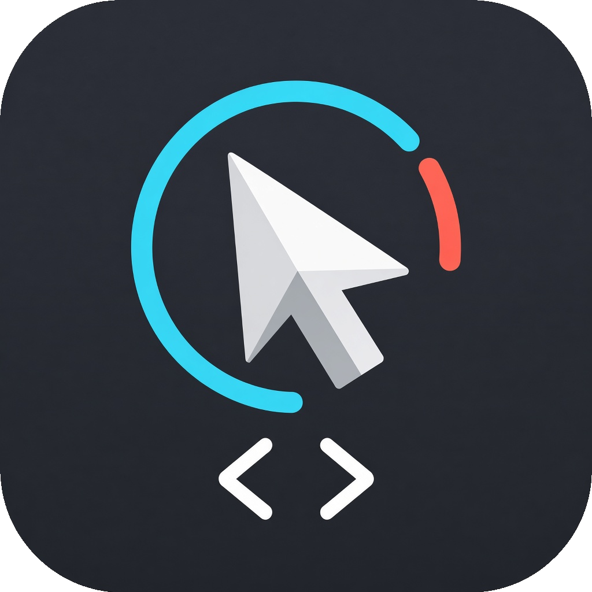
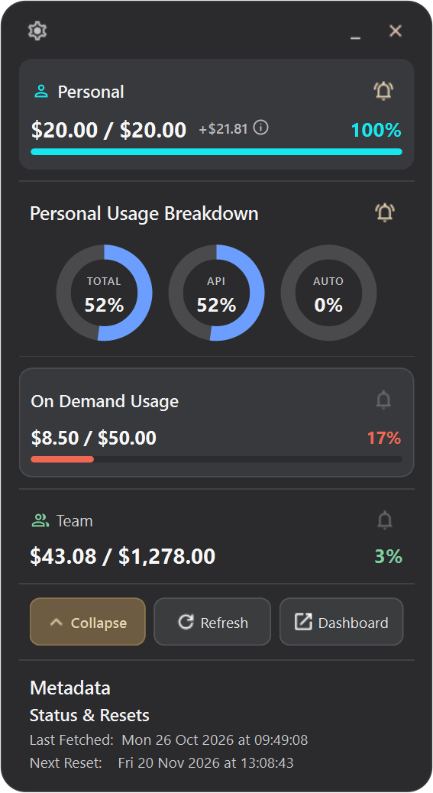
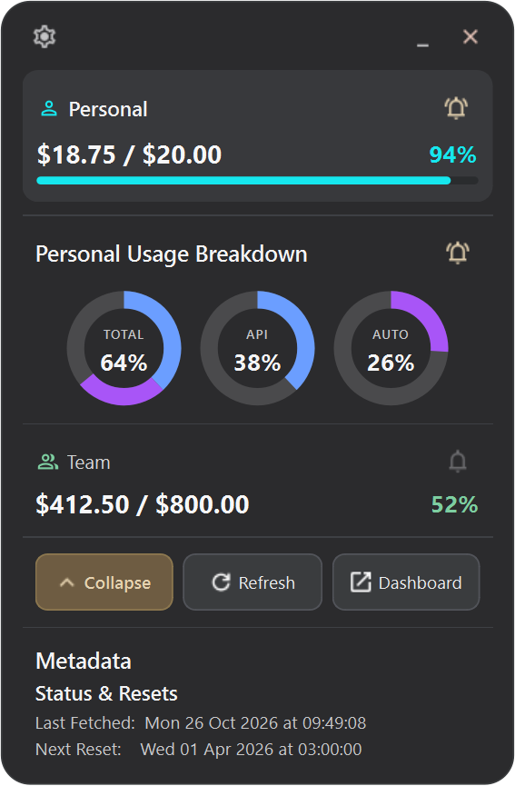
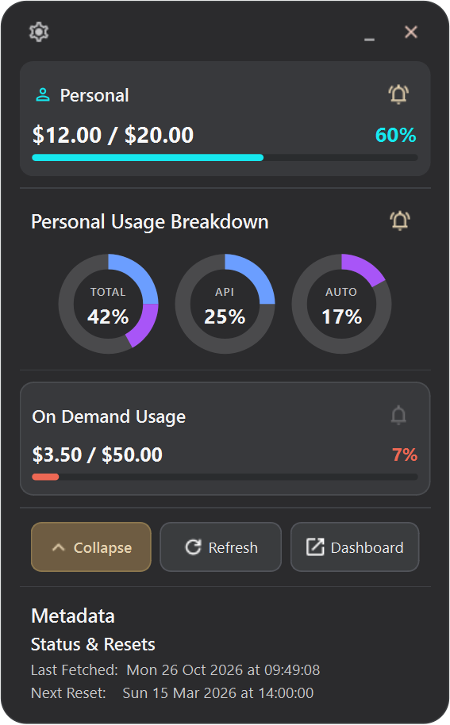
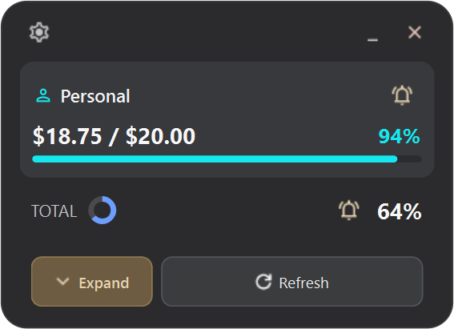
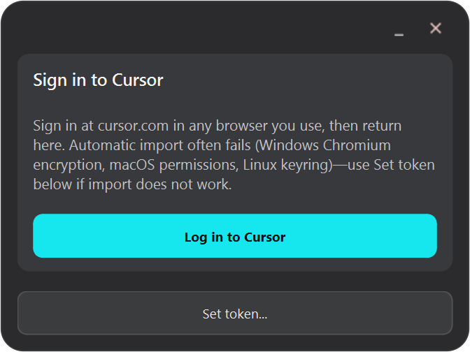

  

# Cursor Usage Monitor

**Unofficial** system tray app and desktop widget for [Cursor](https://cursor.com) usage (`usage-summary` API). Shows personal pool, team pool, plan meters, and optional section alerts. Not affiliated with Cursor or Anysphere.

## Screenshots

Sample data from [test fixtures](tests/fixtures/) (dark theme). The floating window opens from the system tray.

| Enterprise (personal + team + on-demand) | Team plan |
| --- | --- |
|  |  |

| Personal plan | Compact layout |
| --- | --- |
|  |  |

| Sign in (no session) |
| --- |
|  |

Regenerate locally: `python scripts/capture_readme_screenshots.py`

## Install

**Free installers** (no charge) for Windows, macOS, and Linux are on **[GitHub Releases](https://github.com/liran444/cursor-usage-monitor/releases)** — pick the file for your OS.

Details: **[docs/INSTALL.md](docs/INSTALL.md)** (`.exe`, `.pkg`, `.run`). No separate Python install.

CI also keeps per-platform **workflow artifacts** on each release build if you need them from the Actions tab.

## Development

See **[docs/DEVELOPMENT.md](docs/DEVELOPMENT.md)**.

## Authentication

**[docs/AUTH.md](docs/AUTH.md)** — browser import or manual session token.

## Legal

| Topic | Document |
| --- | --- |
| **Privacy** (local data, cookie import, what hits `cursor.com`) | [docs/PRIVACY.md](docs/PRIVACY.md) |
| **Disclaimer** (unofficial, no warranty, API/session risks) | [docs/DISCLAIMER.md](docs/DISCLAIMER.md) |
| **Your code license** | [MIT](LICENSE) |
| **Bundled libraries in installers** | [THIRD_PARTY_NOTICES.md](THIRD_PARTY_NOTICES.md) |

Installers are distributed **free of charge**. The maintainer does not receive your
usage data or session tokens.
